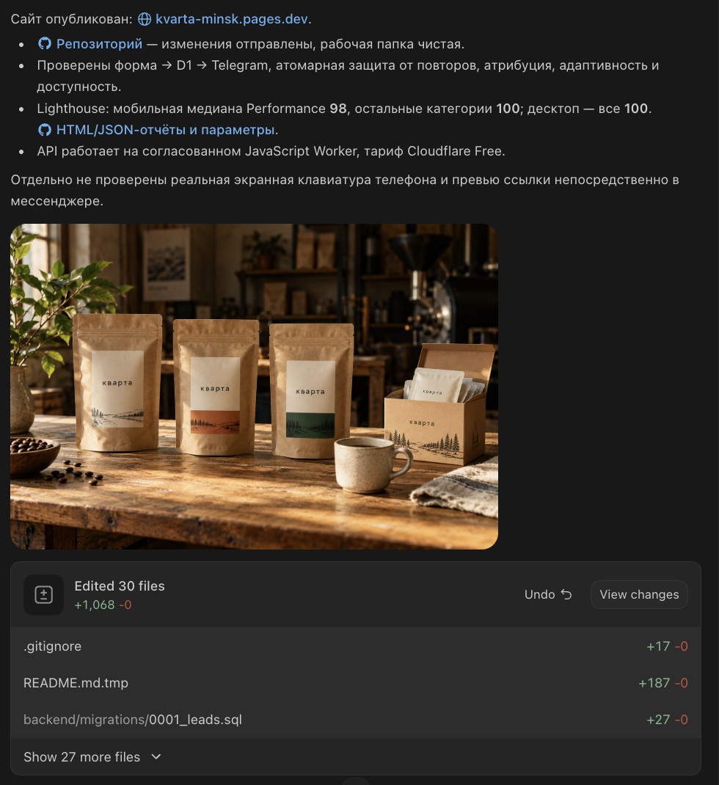
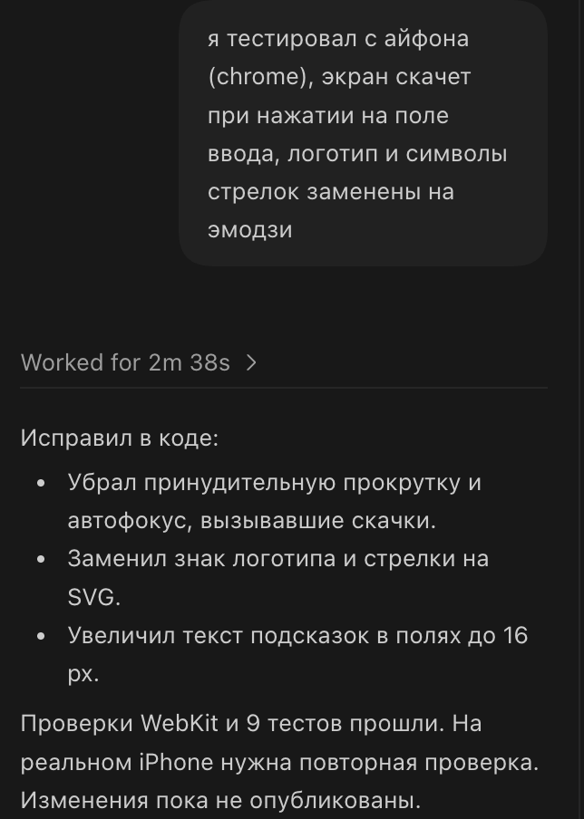
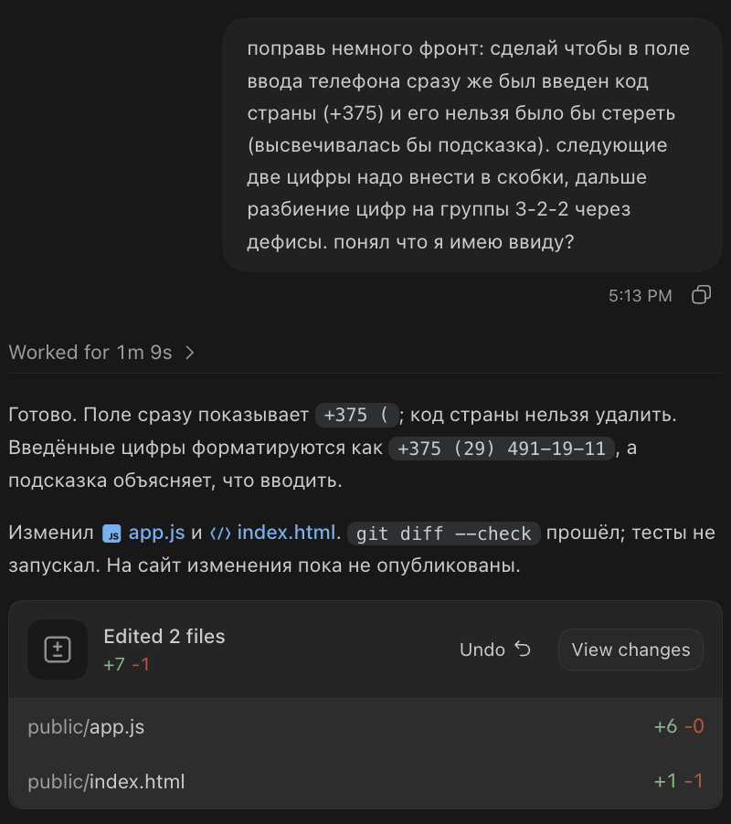
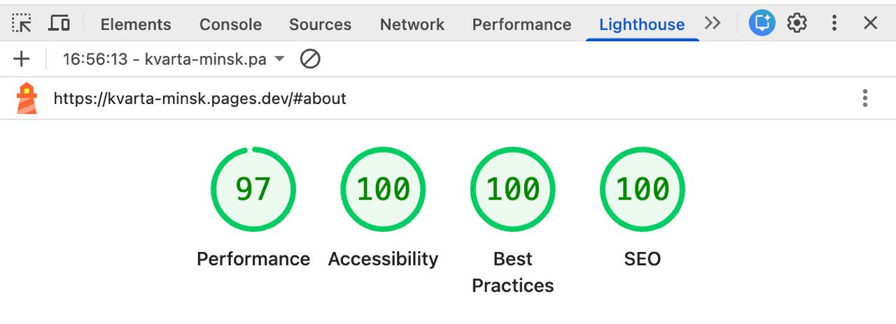
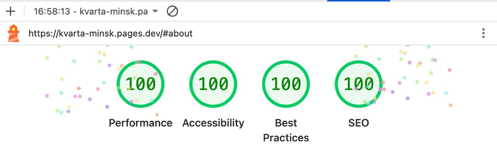

# Кварта · обжарка кофе

- [Сайт](https://kvarta-minsk.pages.dev/)
- [Репозиторий](https://github.com/dima-doroshenko/vitai-test-task)

## Что делал сам и что поручил ИИ

Я задавал направление работы: подготовил с помощью ChatGPT [референс дизайна](https://chatgpt.com/s/cx_6ad367c91a748191a2750cea703a0964) и [промпт для Codex](https://chatgpt.com/s/cx_6ad38fabc41c8191860c865c65943ba6), согласовывал технические решения, проверял настольную и мобильную версии и давал конкретные замечания. Отдельно попросил доработать маску телефона: закрепить код `+375` и форматировать номер как `+375 (XX) XXX-XX-XX`.

Codex написал основную часть кода, настроил хранение заявок и уведомления в Telegram, подготовил тесты и публикацию. Часть иллюстраций сгенерирована ИИ, остальные фотографии взяты с Pexels и Unsplash. Источники и лицензии перечислены в [документации материалов](docs/materials.md).

## Технические решения

Frontend написан на HTML, CSS и обычном JavaScript, без фреймворка и сборки. Сайт размещён на Cloudflare Pages, API работает в JavaScript Worker.

Для хранения заявок выбрал Cloudflare D1, поскольку она нативно интегрируется с Cloudflare Workers. Это позволяет работать с базой напрямую из Worker без отдельного сервера БД и настройки подключения. Возможностей D1 достаточно для хранения заявок и защиты от повторных отправок.

Форма проверяет белорусский номер, сохраняет рекламные метки и страницы перехода. Повторная заявка с тем же нормализованным номером в течение 10 минут не создаётся благодаря SQL-триггеру. Уведомления в Telegram отправляются после сохранения, с повторными попытками при сбоях. Production и preview используют отдельные базы.

## Где ИИ ошибся и как это обнаружилось

Изначально я планировал бэк на Python/FastAPI (привычный мне стек) в Cloudflare Workers. Во время проверки агент обнаружил, что обработка запроса занимает больше CPU-времени, чем допускает бесплатный тариф. Мы сохранили Cloudflare Workers, но переписали бэкенд на JavaScript.

Первого промпта оказалось недостаточно. После переписывания бэкенда агент оставил устаревшие Python-файлы, которые пришлось удалять отдельным шагом. При моей проверке в Chrome на iPhone выяснилось, что при фокусе на полях экран скачет, а знак логотипа и стрелки отображаются как эмодзи. На компьютере эти проблемы не проявлялись. После замечаний агент убрал принудительную прокрутку и автофокус, а символы заменил на SVG.

## Проверки и что сделал бы иначе

В проекте есть 9 автоматических сценариев проверки API, защиты от повторов и доставки в Telegram. На моих скриншотах Lighthouse мобильная версия получила **97 / 100 / 100 / 100**, desktop — **100 / 100 / 100 / 100** (Performance / Accessibility / Best Practices / SEO). В [отдельно сохранённой серии](output/lighthouse/summary.json) из трёх мобильных запусков медиана Performance составила 98; это другой набор замеров.

В следующий раз я бы разбил работу на короткие этапы с проверкой результата после каждого, особенно после смены стека.

## Скриншоты процесса и Lighthouse

Работа с ИИ: первый результат, мобильные ошибки и доработка телефона

Первый результат и отчёт агента:

Мои замечания по мобильной версии:

Доработка маски телефона:

Lighthouse: мобильная и настольная версии

Мобильная версия:

Настольная версия:

